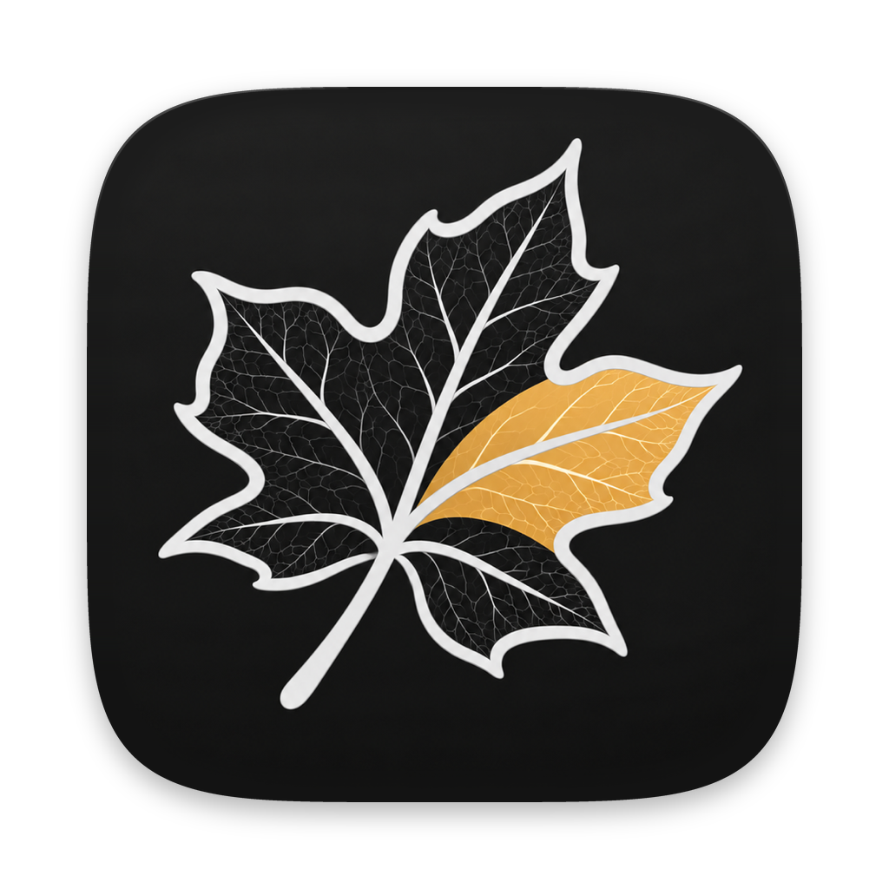
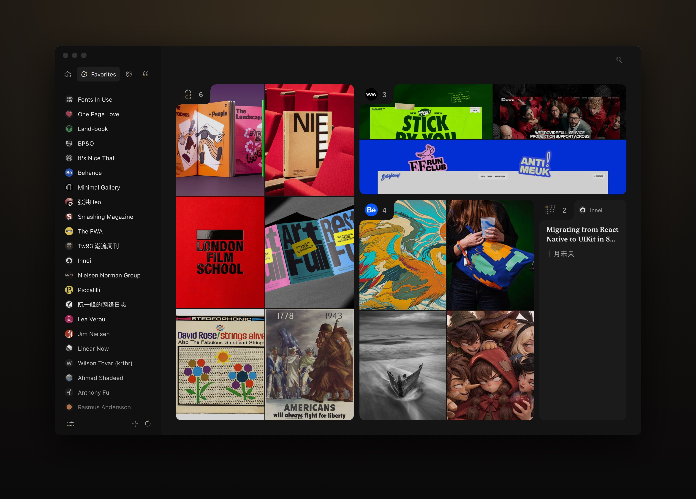
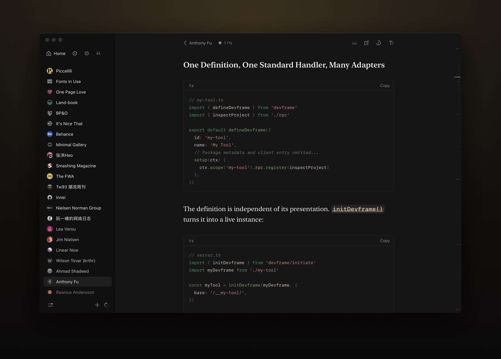

<div align="center">
  
  <h1>Trie</h1>
  <p><b>The next-generation RSS reader for design.</b></p>
  <p>Hand-picked feeds. Work shown in full. Any page, captured in one click.</p>
  <p>English · <a href="README.zh-CN.md">简体中文</a></p>
</div>



Trie is an open-source RSS reader for the Mac that comes already filled: more than sixty hand-picked indie blogs, design writers and design galleries, all readable before you subscribe. Articles open as clean, structured text. Design work opens with its screen recording, screenshots and colour palette. When something is worth borrowing, Trie captures the page as it is, in a folder your coding agent can work from.

## Why Trie

- **Feeds worth reading, already picked.** Indie blogs, design writing, newsletters and galleries in English and Chinese, plus the writers Hacker News, Lobsters, UX Collective and Latent Space point to.
- **Design, not summaries.** A gallery entry opens as the work itself: its recording, every page it shot, its palette and its credits.
- **Capture.** One click captures a page in the background: every screen, all of its text, its images and fonts, in one folder kept in Favourites. Copy its brief and paste it into Claude Code or Codex to rebuild the page. Trie never calls an AI itself.

## Inside

- **Home**: today's design pick, the top stories from the aggregators, what you were halfway through, and new posts from the people you follow.
- **Explore**: every source Trie has picked, open to read without subscribing.
- **Author pages**: one page per writer or site. Follow them to see their new posts on Home.
- **Reader**: headings, code, tables, images and footnotes kept intact, and your place remembered.
- **Favourites**: one click to keep, with undo. The pages you captured are here too.
- **Clips**: keep a paragraph with a note on why, and copy it as Markdown with its source.



## Install

Trie builds from source for now. You need an Apple Silicon Mac and Go 1.27.3 or later.

```sh
git clone https://github.com/konata33/Trie.git
cd Trie/apps/mygo
go tool mygo build -skip-dmg
```

Drag `apps/mygo/build/darwin-arm64/Trie.app` into Applications.

## Your data

- Everything stays on your Mac, in `~/Library/Application Support/Trie`.
- No account, and no usage data collected.
- Trie goes online only to fetch articles, images and page captures, and only from public addresses.
- Explore first pulls a digest from Trie's own site (konata33.github.io/Trie), refreshed every three hours, and reads the sites directly when it cannot. The digest is made by Trie itself, in a scheduled job in this repository.

## Contributing

Start with [CONTRIBUTING.md](CONTRIBUTING.md) for running, checking and packaging. Before changing the interface, read [docs/DESIGN.md](docs/DESIGN.md) and the page in [docs/PAGES.md](docs/PAGES.md); how articles are extracted and shown is in [docs/READER_ENGINE.md](docs/READER_ENGINE.md). Coding agents follow [AGENTS.md](AGENTS.md). The project docs are in Chinese.

## License

The code is released under the [MIT](LICENSE) licence. Site icons, site names and article excerpts in `apps/mygo/resources/explore` belong to their sites, are used only to identify sources inside the app, and are not covered by the MIT licence.
