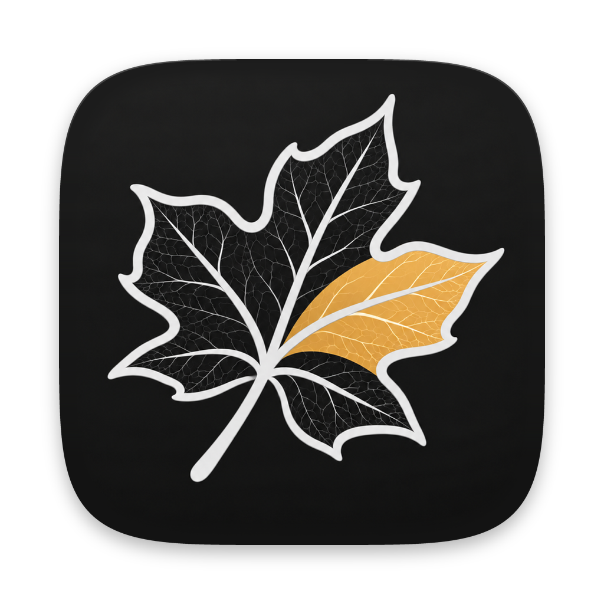
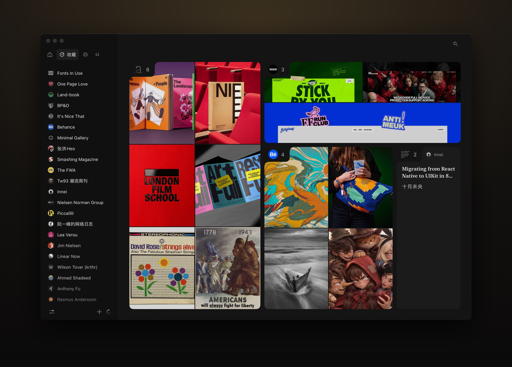
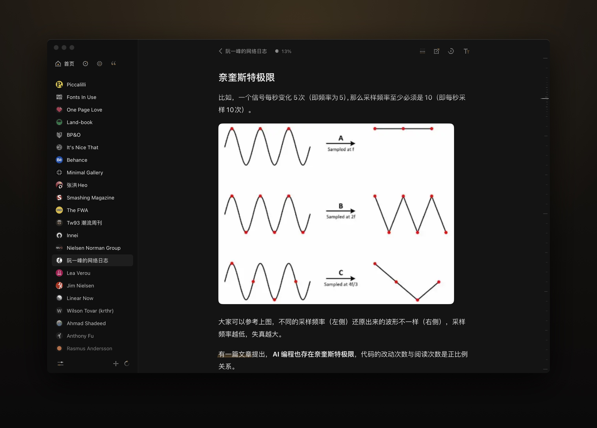

<div align="center">
  
  <h1>Trie</h1>
  <p><b>新一代 RSS 设计阅读器</b></p>
  <p>源已挑好，作品看全，一键交给 AI。</p>
  <p><a href="README.md">English</a> · 简体中文</p>
</div>



Trie 是 Mac 上的开源 RSS 阅读器，装好就是满的：六十多个挑过的独立博客、设计作者和设计画廊，订阅之前就能读。文章打开是干净的结构化正文；设计作品打开带着录屏、截图和配色。看到值得借鉴的，Trie 把这一页拍成一个文件夹，交给你的 coding agent。

## 为什么用 Trie

- **源已挑好**：中英文独立博客、设计写作、通讯和画廊，还有 Hacker News、Lobsters、UX Collective、Latent Space 推荐的作者。
- **作品看全**：画廊里的一件作品，打开就是作品本身：录屏、每页截图、配色和署名，不是一段摘要。
- **一键交给 AI**：在后台把一页拍下来，每屏截图、全部文字、原图和字体放进一个文件夹，把位置贴给 Claude Code 或 Codex。Trie 自己不调用 AI。

## 里面有什么

- **首页**：今天的设计、聚合站排得最高的几篇、读到一半的文章、订阅作者的新文章。
- **探索**：Trie 挑好的全部来源，不订阅也能读。
- **作者页**：一位作者或一个网站一页，订阅后新文章出现在首页。
- **阅读器**：标题、代码、表格、图片和脚注都保留，记住读到哪里。
- **收藏**：一下收好，可以撤销。
- **摘录**：摘下一段，写上为什么摘它，连同出处复制成 Markdown。



## 安装

目前从源码构建，需要 Apple Silicon 的 Mac 和 Go 1.27.3 或更高版本。

```sh
git clone https://github.com/konata33/Trie.git
cd Trie/apps/mygo
go tool mygo build -skip-dmg
```

把 `apps/mygo/build/darwin-arm64/Trie.app` 拖进「应用程序」。

## 数据

- 数据都在本机：`~/Library/Application Support/Trie`。
- 没有账号，不收集使用数据。
- 只在取回文章、图片和网页截图时联网，只访问公网地址。
- 探索页的内容先从 Trie 的网站（konata33.github.io/Trie）取一份每 3 小时更新的汇总，取不到时直接读各个网站。这份汇总由仓库里的定时任务用 Trie 自己生成。

## 参与开发

先读 [CONTRIBUTING.md](CONTRIBUTING.md)，里面有运行、检查和打包的步骤。改界面之前读 [docs/DESIGN.md](docs/DESIGN.md) 和 [docs/PAGES.md](docs/PAGES.md) 里对应的页；正文的提取和显示规则在 [docs/READER_ENGINE.md](docs/READER_ENGINE.md)。coding agent 的约定在 [AGENTS.md](AGENTS.md)。

## 许可

代码以 [MIT](LICENSE) 许可发布。`apps/mygo/resources/explore` 里的站点图标、站点名称和文章摘要归各自的网站所有，只用来在应用里标明来源，不在 MIT 许可范围内。
